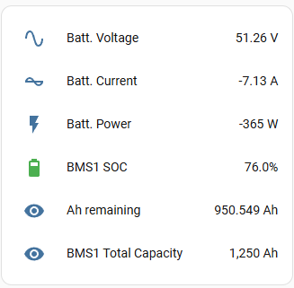

# KM-F Series - Home Assistant integration

Custom integration for the **Junctek KM-F Series** battery monitor (KM105F,
KM140F and friends) with the built-in WiFi module.


Home Assistant opens one TCP connection to the module and keeps it open. The
module pushes its measurement frame on its own, so the values land in Home
Assistant as soon as the device sends them. Nothing goes out to the internet.



## Sensors

| Entity | Unit | Notes |
| --- | --- | --- |
| Voltage | V | 2 decimals |
| Current | A | signed, negative while discharging |
| Power | W | signed, from voltage x current |
| State of charge | % | remaining Ah / set capacity |
| Remaining capacity | Ah | |
| Energy charged | kWh | total increasing, from the `:C` frame |
| Energy discharged | kWh | total increasing, from the `:C` frame |
| Status | - | charging / discharging / idle |
| Time remaining | min | disabled by default |
| Capacity reported | Ah | what the meter says it holds |

Time remaining is disabled by default, enable it from **Settings -> Devices
and Services -> KM-F Series -> Manage**.

## Setting the battery capacity

The device carries one writable value, the preset battery capacity, and the
integration exposes it as a **Set capacity** number entity on the same device.
It is a text box that takes whole ampere-hours from **1 to 9999**, nothing
else; anything outside that range is refused before it reaches the network.

Type the capacity of your battery and press enter. The integration writes the
value, waits for the meter to confirm it by answering the command or by
reporting the new capacity in its next frame, then refreshes so **Set
capacity** and **Capacity reported** settle on the stored number. If neither
happens, the entity keeps the old value and the UI reports the failure instead
of pretending the write worked.

Three things to know before a write fails:

- The module only accepts commands while its **Monitor function** (setting
  21 on the meter) is switched on. That is the same switch the vendor app
  flips when it writes a setting, so if the app can write, Home Assistant
  can too. It cannot be enabled over the network, only from the meter, and
  while it is on the display stops refreshing its own readings.
- The module serves **one client at a time**. If the vendor app or another
  reader holds the connection, the write has nothing to go out on.
- Some network bridges only forward readings. A failed write says so
  outright, in the same message, and tells you to set the capacity on the
  meter under system settings as **AH. preset**; it lands here in
  **Capacity reported** a second later.

**Capacity reported** is what the meter pushes in its `:A` frame, so it is
the proof the new capacity actually landed. After a write the two should read
the same, apart from rounding to whole ampere-hours.

Interface strings ship in English and Romanian. Romanian is picked up when
Home Assistant runs in `ro`; anything else falls back to English.

## Installation

### Marketplace (Home Assistant 2026.11 and newer)

The Marketplace replaced HACS inside Home Assistant. A custom repository
needs three things: it is public on GitHub, it has `hacs.json` in its root,
and the integration lives in `custom_components/kmf_series`. This repository
meets all three.

1. Go to **Settings -> Marketplace**.
2. Top right: **Add from link**, then paste
   `https://github.com/pexicele/haos-kmf-series` and select **Add**. Home
   Assistant asks you to connect a GitHub account the first time; the
   connection is read-only and only reads public data.
3. Open **KM-F Series** in the list and select **Install**. If the content
   type is not detected, choose **Integration** under **Type** and add again.
4. Restart Home Assistant when a repair asks for it.

### HACS (Home Assistant 2026.10 and older)

1. **HACS -> Integrations -> three dots -> Custom repositories -> Add
   repository**, category **Integration**, with the URL above.
2. Close that dialog, search for **KM-F Series**, **Download**, then restart
   Home Assistant.

### Manual

1. Download `kmf_series.zip` from the newest release, or clone the
   repository.
2. Copy `custom_components/kmf_series` into
   `<config>/custom_components/kmf_series`. Keep the folder name, it is the
   integration domain.
3. Restart Home Assistant.

### Releases and updates

A release is not required, without one the Marketplace tracks the default
branch and shows the first seven characters of the last commit as the
version. If you do publish one, tag it `v` plus the `version` in
`manifest.json` (for example `v2.0.0`). `.github/workflows/release.yml`
checks that the tag and the manifest agree, runs the tests, and attaches
`kmf_series.zip`, which is only a convenience archive for an offline host.

## Adding the device

**Settings -> Devices & Services -> Add Integration -> KM-F Series**:

- **Host or IP address**: the address of the WiFi module.
- **TCP port**: `8899`, the default on every KM-F.

The setup form reads one frame from the device before it saves anything, so a
wrong address never becomes a broken entry. If it reports that it cannot read
data, check these in order:

1. The module serves **one client at a time**. Close the vendor app and any
   other reader (Node-RED, ESPHome, the add-on that came with the shunt)
   before adding the integration.
2. Home Assistant and the module must be reachable from each other; the
   module does not answer across a routed VLAN unless the firewall allows it.
3. `nc -vz <ip> 8899` from the Home Assistant host should succeed.

Once it is added, the integration reconnects on its own when the module drops
the link, and the entities go unavailable in the meantime.

## Options

**Settings -> Devices & Services -> KM-F Series -> Configure**.

- **Update interval**: seconds between requests for the cumulative energy
  counters (the `:C` frame). The live measurements do not depend on it, they
  arrive pushed. Range 5 to 3600, default 30.

## The protocol

Plain ASCII over TCP on port `8899`, one line per frame, LF terminated.

```
:A=4810,567,0,421,3986,100,...
```

| Field | Meaning | Scale |
| --- | --- | --- |
| 0 | Voltage | /100 -> V |
| 1 | Current, absolute value | /1000 -> A |
| 2 | Direction, 1 charging, 0 discharging | - |
| 3 | Minutes remaining | minutes |
| 4 | Remaining capacity | /1000 -> Ah |
| 5 | Reported capacity | /10 -> Ah |
| 6+ | Firmware specific, ignored | - |

```
:C=12,41,...
```

| Field | Meaning | Scale |
| --- | --- | --- |
| 0 | Energy charged | /1000 -> kWh |
| 1 | Energy discharged | /1000 -> kWh |

Sending `:A\n` asks for one measurement frame, `:C\n` for the counters. The
integration uses `:A\n` as a keep alive when the module goes quiet and `:C\n`
on the configured interval.

Writes use a third frame type, `:W`, and that is CRLF terminated:

```
:W28=1,216,2000,\r\n     -> battery capacity set to 200.0 Ah
  ^^  ^^^ ^^^^  ^^^^
  ||  ||  ||    +-- parameter, tenths of an Ah
  ||  ||  +-------- checksum of the parameter, (parameter mod 255) + 1
  ||  +----------- meter address, 1 by default
  +--------------- function 28, set battery capacity
```

The integration sends that frame with a CRLF terminator, as the manual asks.
If nothing confirms it, it sends the same frame again terminated with a bare
LF: CRLF is documented for the RS-485 and Bluetooth links, while the WiFi
module only ever sends LF itself, and a bridge that splits incoming lines on
LF alone would find a stray carriage return at the end of the last field and
can drop the command without a word.

The integration takes either of those replies as confirmation, and it also
accepts a module that answers nothing at all as long as the next `:A` frame
reports the new capacity. That read back is the stronger proof of the two, it
is the same number **Capacity reported** shows, and it covers firmware that
forwards a write in silence.

When neither proof arrives, the integration sends the capacity the meter
already reports. That frame changes nothing, the stored setting is the same
before and after it, but the way the module treats it says which of two
failures happened, and the error message then names one instead of guessing:

- It answers that frame. The link takes writes and only the requested value
  went unanswered, so the thing to check is the **Monitor function** at the
  meter, plus any second client hogging the socket.
- It stays silent about it too, while its `:A` frames keep arriving. This
  network port carries readings only. The manual documents writes over RS-485
  and Bluetooth, and nothing says a network bridge has to forward them, so
  some modules simply do not. Set the capacity at the meter itself, under
  system settings as **AH. preset**, and it shows up in **Capacity reported**
  on the next frame.

The manual never describes this TCP port, and neither the `:A` nor the `:C`
frame appears in it, so what a given module forwards upstream depends on the
bridge firmware. The official app is Bluetooth only, which is why it can
write where this socket cannot.

One trap worth knowing: protocol function `W21` is the under-voltage
protection, **not** the Monitor function. The Monitor function is setting 21
in the meter's own menu and can only be switched on from the meter's display,
which is why the integration cannot enable it for you. While it is off, the
meter ignores commands, and switching it on also stops the display from
updating its readings on its own.

## Development

```
python3 tests/test_parser.py       # frame parsing
python3 tests/test_client.py       # client, writes, fake module
python3 tests/test_integration.py  # full lifecycle against a fake HA
```

No third-party test dependencies beyond `voluptuous`, and the tests run
against a plain CPython with a stand-in for the Home Assistant API.

## Credits

The frame layout was worked out from the public KM-F reports and from
`Barlows/ha-addon-km140f` (MIT). The write frames, function numbers and the
checksum rule come from the Juntek KG-F manual and from the community
code of pljakobs/JuncTek_Batterymonitor.

## License

MIT
